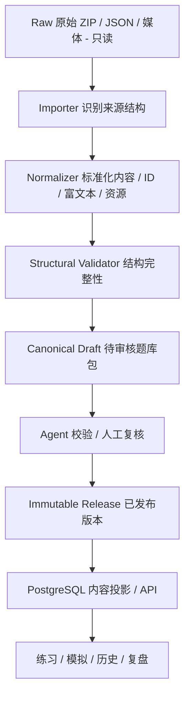

# JLPT GO 2.0｜Canonical 题库标准 v2.0（草案）

> 日期：2026-11-15  
> 文档状态：**设计草案 v0.1；尚未开发、导入或修改旧版数据库**  
> 定位：规定 **JLPT GO 自己的标准化交换数据**，而不是复制上游 API 或要求 PostgreSQL 表与 JSON 文件逐一对应。  
> 适用：N5–N1 的试卷导入、内容校验 Agent、内容管理、普通练习、完整模拟与日后系统升级。  
> 参考源：`1EPlaLzGnX.zip`（原始 2018-12 N2）、`exams.json/questions.json/assets.json`（先前加工样本）、旧项目数据库设计与 PRD v0.1。此前设计为输入，不构成新增需求已经确认。

## 0. 设计决策总览

### 已确认的产品边界

- **JLPT GO 1.0 继续运行**；2.0 使用独立代码库、数据库和开发环境。
- 本次是设计全新规范，**不覆写原始文件、不修改旧版数据、不开始编码**。
- 独立单题和共用材料多题都使用 Unit；**Unit 为完整展示、随机选取与即时反馈的最小单位，Question 为评分与学习统计单位**。
- 普通练习允许未答题提交、区分错与未答；历史错题保留并按最近有效正误筛选；智能随机以新题为主，保留约 20%–30% 复习候选。
- 题库转换与 Agent 内容校正是不同工序。将原始数据转成自己的格式，不等于题目答案正确，也不改变题目、图片、音频的知识产权归属。

### 本稿待评审的架构决定

- 标准数据以**每份试卷一个可验证的数据包**为交付单位，核心数据使用 JSON/JSONL，媒体二进制独立引用。
- 自定义稳定 ID 与来源 ID 分离；source mapping 仅在内部受限归档中保存。
- 富文本采用受控的语义节点格式（RichText v1），不将原始 HTML 作为产品的规范存储格式。
- 正式发布使用**不可变 Release 快照**；题干、答案、解析修订以候选版本提交，用户历史引用当时的 Release。
- 内容交换规范不直接承载练习会话表或用户历史表；这些在后续数据库领域模型中设计。

## 1. 总体分层



- **Raw**：保存原件、原始 SHA-256、来源字段与资源二进制，不修改。一个 ZIP 中不同冗余文件只选择一个权威题目树。
- **Canonical Draft**：字段、结构、关系合规，但内容未必正确，也不一定可发布。
- **Review**：检查题干、选项、答案、解析、翻译、音频/图片，记录待人工处理项。
- **Release**：发布快照及其哈希不可原地改写；修订产生新的 Release。
- **DB Projection**：按查询性能和事务拆表。外部 JSON 规范是内容交换契约，不是数据库 ERD 的直接镜像。

## 2. 核心层级与最小单位

```text
Exam（试卷）
└── Section（文字词汇 / 文法 / 读解 / 听力）
    └── Layer（問題 1…）
        └── Unit（独立题、文章、音频段、共用图像等）
            └── Question（逐题答案与评分）
                └── Option（选项）
```

- `Section` 是**目录与题库的内容分类**，不是严格模拟的计时阶段；考试 Phase 要在运行时规则中另建模。
- `Layer` 是试卷的大题（例如文法問題 7），**不能等同于同一材料组**。
- **每一道 Question 恰好从属于一个 Unit**。原始 `dataType=22` 直接挂在大题下的题目，转换时单独生成一个 `single` Unit。
- 原始 `dataType=21` 的真实材料组，通常转换为一个 Unit，其下含一题或多题。不要将原 `dataType` 当作最终业务规则。
- 用户选择「练习本大题」时，属于**一次 Session 含多个 Unit**，并不将这些 Unit 合并成一个大 Unit。

### 2018-12 N2 的样本期望

| 项目 | 数量 | 计算方法 |
|---|---:|---|
| 大题 | 19 | 原始 `question_groups.json` 顶级 `dataType=20` 节点 |
| 显式材料组 | 41 | 大题下 `dataType=21` 节点 |
| 独立单题 | 47 | 直接挂在 `dataType=20` 下的 `dataType=22` 节点 |
| Canonical Unit | **88** | 41 + 47 |
| Question | **103** | 所有 `dataType=22` 叶子节点 |
| MediaAsset | **37** | `resources.json`，35 音频 + 2 图片 |

> 注意：以上是该原始包的具体基准，不应该硬编码为所有等级的规律。后续应使用 N1、N3、N5 和不同年份各至少一套原始样本做结构兼容测试。

## 3. Canonical Package v2.0

```text
JLPTGO-N2-2018-12-r1/
├── manifest.json                 # 版本、清单、数量、SHA256、导入/审查状态
├── exam.json                     # Exam 单记录
├── sections.jsonl                # Section 列表
├── layers.jsonl                  # Layer 列表
├── question_types.jsonl          # 本包用到的 JLPT GO 题型字典子集
├── units.jsonl                   # Unit + 有序 Materials（正文/字幕/媒体引用）
├── questions.jsonl               # Question + Options（不含正确答案）
├── answer_keys.private.jsonl     # 正确答案（服务端专用，禁止直接提供给考生）
├── explanations.jsonl            # 题目解析 / 翻译及其审查状态
├── assets.jsonl                  # 媒体元数据与对象存储键
├── provenance/
│   └── source_refs.private.jsonl # SourceID -> CanonicalID，内部追溯，不发给前端
└── reports/
    └── import_report.json        # 转换警告、待人工判定项、缺失项
```

正式发布只包含被发布系统认可的文件集合与发布清单；`.private` 是**角色和接口层面的隔离要求**，不能仅靠文件名保障安全。可将真实音频/图片放在存储服务中，本包的 `storage_key` 指向已经核对哈希的对象。生产环境可按需拆分包中资产索引，不要求文件结构成为用户可见 URL。

### 统一记录约定

- 顶层记录带 `record_type` 和 `schema_version: "2.0.0"`；子对象不重复该字段。
- ID 由 JLPT GO 分配，**不复用**原始 `objectId` / `identity` / 处理后 `question_id` 作为新项目业务主键。
- ID 生成后写入**持久映射注册表**，同一数据再次转换时必须复用该 ID，不能每次导入都生成一套新 UUID。
- 排序只由整数 `position` 决定；打印题号单独由 `printed_number` 表示，不能按 ID、标题排序。
- 时间字段统一 ISO-8601 UTC；字段缺失与空字符串、未知、确实不存在是不同概念，按字段规范使用 `null` 或显式状态。
- Unicode 保留原题重要排版：不批量 NFKC 折叠全角字符、不擅自调整日语空格、标点、下划线和 `★`。
- 版本化数据包通过 `schema_version` 区分结构演进，通过 `release_id` / `content_hash` 区分内容发布。
- 内容哈希对稳定内容字段做确定性序列化（键名顺序统一、UTF-8、明确排除运行时间/导入日志）；在导入器中固定算法版本。

## 4. 实体定义

下面是**标准文件层的逻辑字段**。PostgreSQL 实体可进一步拆表、增加复合索引或只读投影。

### 4.1 `Manifest`（`manifest.json`）

| 字段 | 类型 | 约束 / 说明 |
|---|---|---|
| `record_type` | literal | `manifest` |
| `schema_version` | string | 本规范 `2.0.0` |
| `package_id` | string | 本次独立数据包标识 |
| `exam_id` | string | 指向 Exam 的稳定 ID |
| `release_id` | string/null | 草稿为 `null`，发布后关联不可变 Release |
| `content_hash` | string/null | 数据包内容哈希；草稿可空 |
| `counts` | object | layer、unit、question、asset 的实际计数 |
| `files` | array | 文件路径、SHA256、字节数；只枚举规范输出文件 |
| `source_archive_sha256` | string | 原始 ZIP 或原始输入批次的校验值 |
| `conversion_version` | string | 转换程序版本，方便重现 |
| `state` | enum | `draft / review_ready / release_candidate / published` |

### 4.2 `Exam`（`exam.json`）

| 字段 | 类型 | 约束 / 说明 |
|---|---|---|
| `id` | string | JLPT GO 稳定主键 |
| `level` | enum | `N1..N5` |
| `year` | integer | 考试年份；`supplementary` 为 null（ADR-0030） |
| `month` | integer | 1–12，不写死仅 7、12；`supplementary` 为 null |
| `title` | string | 非空显示标题 |
| `kind` | enum | `past_exam / mock_exam / supplementary`（扩展练习，ADR-0030：无年月、不进历年试卷目录与专项抽样）；类型不等于版权许可 |
| `full_audio_asset_id` | string/null | 整卷音频资源，可能没有 |
| `status` | enum | `draft / review / published / archived` |

同年度、月份、等级如果允许多份卷，需额外区分 `variant_key`；不要仅以 `(level, year, month)` 作为全局唯一键。对外能否发布需要额外的版权与质量审核，不从 `kind` 推断。

### 4.3 `Section`（`sections.jsonl`）

| 字段 | 类型 | 约束 / 说明 |
|---|---|---|
| `id` | string | 稳定 ID |
| `exam_id` | string | FK Exam |
| `subject` | enum | `vocabulary / grammar / reading / listening` |
| `position` | integer | 同卷内唯一，正整数 |
| `title` | string | 显示名称 |

### 4.4 `QuestionType`（`question_types.jsonl`）

| 字段 | 类型 | 约束 / 说明 |
|---|---|---|
| `id` | string | JLPT GO 语义 ID，如 `grammar_cloze`，不使用原始 `23` 作为长期接口标识 |
| `subject` | enum | 对应科目 |
| `label_zh` / `label_ja` | string | 面向用户的题型名 |
| `answer_mode` | enum | 当前仅 `single_choice`，保留未来扩展能力 |
| `default_unit_kind` | enum | 仅建议值，不能覆盖实际组题关系 |

原始整数类型 `11/12/21/22/23/31/…` 放在内部 `source_refs` 的映射或独立 ETL 配置，不作为前端条件分支。若源题型与源大题类型不一致，输出警告并人工确认。

### 4.5 `Layer`（`layers.jsonl`）

| 字段 | 类型 | 约束 / 说明 |
|---|---|---|
| `id` | string | 稳定 ID |
| `section_id` | string | FK Section |
| `question_type_id` | string | FK QuestionType；大题类型 |
| `position` | integer | 同科目内唯一 |
| `display_label` | string | 例如 `問題 7`，听力可从 `問題 1` 重排 |
| `instruction` | RichText | 大题的题型说明，不能默默丢失原文 |

### 4.6 `Unit`（`units.jsonl`）

| 字段 | 类型 | 约束 / 说明 |
|---|---|---|
| `id` | string | 稳定 ID |
| `layer_id` | string | FK Layer |
| `question_type_id` | string | 本 Unit 的已核对题型 |
| `kind` | enum | `single / passage / cloze / comparison / visual / audio` |
| `position` | integer | 同 Layer 内唯一；与原始 `items[]` 顺序一致 |
| `label` | string/null | 文章 1、音频 2 等；可由顺序生成 |
| `materials` | Material[] | 有序材料数组；可空（普通独立题） |
| `slot_ids` | string[] | Unit 中的所有填空锚点；非填空题为空 |
| `conversion_status` | enum | `complete / needs_review / blocked` |

**Material（Unit 内嵌）**：`id`、`kind`（`passage/image/audio/transcript/instruction`）、`role`（`primary/comparison_a/comparison_b/illustration` 等）、`language`、`content`（可空 RichText）、`asset_id`（可空）、`cues`（可空有序字幕段）、`translated_from_material_id`（可空）。文字材料必须能还原日文原文；比对阅读 A/B 应保留材料区分。字幕原文与字幕翻译是不同语言的 Material，不应拼成无法对齐的长字符串。

**Unit 的行为规则**：

- 对 `single` 类型，一道 Question 就是完整 Unit。
- 多题 Unit 必须保留全部 Question；随机抽题、即时反馈、逐题复盘遵循 Unit 边界。
- `cloze` 的每个填空可用 `slot_id` 绑定对应 Question；无法可靠定位时保留原始可见编号文本，并标记 `needs_review`，**不得猜位置**。
- 资料可能只有图片或音频，没有正文。禁止因为 `title` 为空就过滤 Unit。

### 4.7 `Question`（`questions.jsonl`）

| 字段 | 类型 | 约束 / 说明 |
|---|---|---|
| `id` | string | 稳定 ID |
| `unit_id` | string | FK Unit，非空 |
| `question_type_id` | string | FK QuestionType（允许与大题不同，但必须验证） |
| `position` | integer | Unit 内顺序，正整数 |
| `printed_number` | string/null | 试卷上展示的题号，可能不同于 `position` |
| `prompt` | RichText/null | 题干；听力或文章填空可能只有材料和编号 |
| `options` | Option[] | 初版均为单选，现有样本出现 3、4 项，**不强制 4 项** |
| `slot_id` | string/null | 若题目对应 `cloze` 材料空格，指向该 Unit 的 slot |
| `media_asset_ids` | string[] | 专属此题的图片等；共用材料应位于 Unit |
| `conversion_status` | enum | `complete / needs_review / blocked` |

**Option（Question 内嵌）**：`id`（同 Question 内稳定标识）、`position`（1 基显示顺序）、`content`（RichText）、`media_asset_ids`（可选）。本规范将 Option 内嵌在文件记录中；数据库可以单独建 `question_options` 表。

### 4.8 `AnswerKey`（`answer_keys.private.jsonl`）

| 字段 | 类型 | 约束 / 说明 |
|---|---|---|
| `question_id` | string | FK Question |
| `revision` | integer | 每次正式答案修订递增 |
| `answer_mode` | enum | 初版 `single_choice` |
| `correct_option_ids` | string[] | 初版必须恰有 1 个，并且属于该 Question 的 options |
| `review_status` | enum | `unverified / agent_checked / human_reviewed / disputed` |
| `source_answer_index` | integer/null | 仅内部过渡审计字段；新客户端不能依赖 |

原始 `rightAnswer` 是**字符串形式的 0 基索引**，转换为选项稳定 ID 时必须校验 `0 <= index < options.length`。不能把原始 `"0"` 存成正确选项字符串 ID，也不能认为印刷选项序号总是 1–4。

### 4.9 `Explanation`（`explanations.jsonl`）

| 字段 | 类型 | 约束 / 说明 |
|---|---|---|
| `id` | string | 稳定 ID |
| `owner_type` | enum | `question / unit`（文章全文翻译可能属于 Unit） |
| `owner_id` | string | FK 对应对象 |
| `kind` | enum | `analysis / translation / note` |
| `language` | string | BCP-47，如 `zh-CN / ja-JP / en` |
| `content` | RichText | 解析 / 翻译的正式标准内容 |
| `revision` | integer | 内容修订版本 |
| `review_status` | enum | `missing / unverified / agent_checked / human_reviewed / disputed` |

解析和原文不是同一回事。源 `analysisisOk=true` 只是来源元信息，**不能直接映射为 `human_reviewed`**。例如文章翻译如果在原始 `dataType=21` 上，就应生成 `owner_type="unit"` 的翻译，不能硬塞进第一道 Question 的解析。

### 4.10 `MediaAsset`（`assets.jsonl`）

| 字段 | 类型 | 约束 / 说明 |
|---|---|---|
| `id` | string | 稳定 ID；同哈希媒体可共享 |
| `storage_key` | string | 经过校验的内部文件键，不是原始文件路径 |
| `mime_type` | string | 根据文件签名/可用解析器验证，不仅靠扩展名 |
| `sha256` | string | 二进制 SHA-256 |
| `size_bytes` | integer | 真实字节长度 |
| `duration_ms` | integer/null | 音频时长，未测得则为 `null` |
| `availability` | enum | `verified / missing / corrupt / unchecked` |

链接关系：`Exam.full_audio_asset_id` 关联整卷音频；`Unit.materials[].asset_id` 关联共用媒体；`Question/Option.media_asset_ids` 用于题目或选项专属媒体。不能假设源 `images/` 路径内只有图片。

### 4.10a `ExamPhase`（`phases.jsonl`，可选，ADR-0019）

严格模拟的计时阶段，与 `Section`（内容分类）分开建模。**文件可缺省**：无 `phases.jsonl` 的包照常导入发布，只是不提供模拟入口；不得写空占位文件。纳入内容哈希且排在哈希顺序最后，因此缺省的旧包哈希不变，加入 Phase 后产生新哈希、新 Release。

| 字段 | 类型 | 约束 / 说明 |
|---|---|---|
| `id` | string | `<exam_id>-ph<position>`，包内唯一 |
| `exam_id` | string | 必须等于 exam |
| `position` | integer | 正整数，包内唯一，即考试顺序 |
| `title` | string | 如「言語知識（文法）・読解」 |
| `duration_seconds` | integer | 正整数；官方时限，随 Release 固化 |
| `subjects` | string[] | 非空，取自 `vocabulary/grammar/reading/listening`；同一科目只属于一个 Phase |
| `playback_policy` | object/null | 听力 Phase：`{"playback":"once","pausable":false,"seekable":false,"speed_control":false}`；其他为 `null` |
| `rule_source` / `rule_checked` | string | 时限规则的来源 URL 与核对日期（说明性） |

校验：每个 Unit 通过其 Layer 的科目恰好落入一个 Phase；不允许空 Phase；缺任一所需科目的试卷由转换器**整体不生成** Phase（不做部分模拟）。发布时写入 `release_exam_phases`，Unit 归属按「Section → Layer → Unit」顺序写入 `release_phase_units`。各级别时限规则表在转换器 `PHASE_RULES`（来源 jlpt.jp，见 ADR-0019）；规则表变化只影响新生成的 Release。

### 4.11 `Provenance`（仅内部）

| 字段 | 类型 | 说明 |
|---|---|---|
| `source_system` | string | 源系统的标识，用于内部追溯 |
| `source_archive_sha256` | string | 原始归档指纹 |
| `source_object_id` | string/null | 原始 `objectId` |
| `source_identity` | string/null | 原始 `identity` |
| `source_node_path` | string | 例如 `layers[10].items[0].items[2]` |
| `canonical_type / canonical_id` | string | 映射到自己的稳定对象 |
| `raw_node_hash` | string | 原始节点校验哈希 |
| `transform_version` | string | 转换程序版本 |

该记录仅在内部保存，不进入公开业务 API。保留源标识用于追溯，不代表用户可向来源系统泄露这些数据。

## 5. RichText v1（独立于原始 HTML）

使用 `{"format":"jlptgo-richtext-v1","blocks":[...]}`。`blocks` 初版支持：

- `paragraph`：普通段落，包含 `children`。
- `heading`：分段标题。
- `list`：有序/无序列表；保留缩进与顺序。
- `table`：二维文本单元格，用于图表/信息检索。
- `image`：引用 `asset_id`，可带说明。

`children` 支持 `text`（`marks: ["underline", "bold", "italic"]`）、`ruby`（日文假名标注）、`slot`（稳定填空锚点）、`break`（段内换行）。以后增加更多节点必须提升富文本版本，且编写向前兼容迁移器。

例如一条普通题目：

```json
{
  "format": "jlptgo-richtext-v1",
  "blocks": [{"type": "paragraph", "children": [
    {"type":"text","text":"二人は"},
    {"type":"text","text":"離れて","marks":["underline"]},
    {"type":"text","text":"座った。"}
  ]}]
}
```

**无损原则**：

1. 原始 HTML 解析使用受限白名单与语义转换，不把上游 `class`、`data-*` 字段原样暴露为前端契约。
2. 日语原文、标点、全角空格、题号、粗体/下划线、`★`、填空与 A/B 文章区分必须保留；避免全局 `strip()` 或 NFKC 误改题意。
3. 原始 `<MOJiTest_URL>` 是**待解析来源占位符**；不能作为网页 URL 输出或在转换失败时直接丢弃。必要时由对应图片/音频素材替代并输出待验证报告。
4. 音频字幕若含开始/结束时间，解析为毫秒并按源顺序保存；无效或缺失时间标记 `needs_review`，不人工猜测时间戳。
5. 无法无损表达的来源片段放入内部导入异常报告，并保留原始节点指纹；**不能悄悄删除难处理的内容**。

## 6. 导入器转换规则（Raw → Canonical）

| 来源 | 转换目标 | 核对要点 |
|---|---|---|
| `metadata.json` | Exam | 年月、等级、title、资源引用 |
| `question_groups.json` 根层 `dataType=20` | Layer | 大题顺序、说明、题型 |
| `dataType=20` 下直接的 `dataType=22` | 单题 Unit + Question | 生成 Unit 的 ID 和排序，不改变题目顺序 |
| `dataType=21` | Unit + Materials | 题组正文、译文、音频、图片、字幕 |
| `dataType=21.items[]` 的 `dataType=22` | Question + Options + AnswerKey + Explanation | 子题顺序、正确选项索引、解析 |
| `resources.json` + ZIP 二进制 | MediaAsset | MIME、SHA、大小、中文文件名编码 |
| 原 `analysisisOk` / `contentUpdatedAt` | 内部来源信息 | 用于校验线索，但不提升审核状态 |

**同包数据的冗余路径**：`exam.json`、`question_groups.json`、`groups/*.json` 存在重复题目结构，不能三份都导入计数。当前建议以 `question_groups.json` 为题树权威，`metadata.json` 为试卷头信息，`resources.json` 为资产清单；其他原文件仅作为**一致性对照**。若某批原包不满足，进入人工核对分支而不是静默换源。

**文件名编码**：本包资源清单中完整听力音频的中文名，与 ZIP 条目名按原始字符串匹配时不一致，但二进制确实存在；对于未置 UTF-8 标志的文件名，应采用可验证的 CP437 字节恢复 UTF-8 路径，仅在转换结果**完全匹配清单**、字节数一致时采纳。保留原始 ZIP 条目名与修复日志；不能对未知编码盲目重写全部路径。

**关于翻译归属**：原始材料组上的 `translation` → Unit 级 Explanation / 对应语言 Material；原始 Question 上的 `analysis` → Question 级 Explanation。若有问题本身的译文，则挂到 Question；不把不同所有者的文本混合。

## 7. 校验层次与发布门槛

### 7.1 结构校验（导入器负责）

- 记录必须符合 Schema 版本，ID 不重复，外键都可以解析，同层 `position` 唯一且为正数。
- 每个 Unit 至少一题；每个 Question 只归属一个 Unit；`single` Unit 正好一题。
- 选项稳定 ID 无重复、显示顺序不重复、当前单选至少两项；正确答案 ID 必须属于本题选项。
- `cloze` 的 `slot_id` 要么在 Unit 富文本中存在且映射唯一，要么记录为 `needs_review`，不能默认为已无损转换。
- 媒体引用有效，资源实际存在且二进制哈希匹配；缺失资源阻断依赖该资源的 Unit 发布。
- 对每一份试卷核对原始叶节点题数、Layer 数、归一后 Unit 数、各科目题数，并输出完整性报告。

### 7.2 内容校验（Agent + 审核负责）

- 正确答案与解析按内容哈希绑定审核，题目修订导致旧 Agent 结论失效。
- 将 `answer_review_status`、`explanation_review_status`、`media_availability` 与结构校验分开存储。
- 源答案合法不等于语言学上正确；源 `analysisisOk` 不等于人工复核。
- 题组若存在待处理关键材料，**整个 Unit 暂不发布**；完整模拟需整张卷达到发布门槛。具体人工复核比例、版权许可由后续发布策略确认。

### 7.3 2018-12 N2 验证门槛

| 核对项 | 预期 |
|---|---:|
| Layer | 19 |
| 显式源 Group | 41 |
| 生成 Single Unit | 47 |
| Canonical Unit | 88 |
| Question | 103 |
| 资源清单与二进制关联 | 37 条可关联（含待修复 ZIP 中文文件名） |
| 文字词汇 / 文法 / 读解 / 听力 | 30 / 22 / 21 / 30 题 |

完成测试时应输出原始节点到 Canonical ID 的逐项映射以及重复/缺失/不确定数量；不能只比较合计 103。

## 8. 题库校验 Agent 对接

- Agent 的**输入**是 Canonical Unit 的完整材料、其全部关联 Question、候选 AnswerKey/Explanation、媒体可访问引用及内容哈希；必要时给只读的来源片段作为辅助证据。
- Agent 的**输出**是按 Question/Unit 绑定内容哈希的审核结论、错误定位、候选修改和证据；不直接写发布库。
- 审核程序检查哈希是否仍匹配；旧修订建议遇到新版本时标记冲突，不直接覆盖。
- N5–N1 可按试卷分包、按 Unit 切分任务，支持断点续跑、重试和批量报告；对内容依赖的共用文章不可只给 Agent 单独一道题。
- 正式校验协议应在此 Canonical 标准上升级旧的 `Agent Validation Contract v0.1`，而非继续以扁平 `questions.json` 为最终输入格式。

## 9. 版本、发布与历史关联

- **Schema 版本**：`2.0.0`，字段结构升级时按语义化版本明确兼容范围。
- **内容版本**：`publication_release`，一次发布绑定一套不可变的 Exam、Unit、Question、答案、解析与资源快照。
- 草稿可以多次修改；发布后不能原地覆盖；题目修订在新 Release 发布。
- 作答会话创建时固定 `release_id`、Unit/Question 顺序及正确答案版本；考生在作答或模考期间不能得到答案密钥。
- 成绩回顾使用用户当时所答版本。管理员可以生成纠错说明或独立重判记录，但**不静默重写历史得分**。
- 只变更解析不应影响历史选择及判分；变更正确答案要标记受影响的发布版本与历史作答。

## 10. 数据包、数据库与 API 的边界

**Canonical Package** 是内容交换标准；数据库可以采用如下建议的关系投影：`exams / sections / layers / units / unit_materials / questions / options / answer_key_versions / explanation_versions / media_assets / releases / source_mappings / import_jobs`。一份 `questions.jsonl` 可以展开到 `questions + options` 两张表，不要求文件和表一一对应。

**Study Domain** 不属于题库数据包：`study_sessions`、草稿、已提交答案、成绩、学习统计等另建表，并引用 `release_id` 和 `question_id`。因此无需因为改变题库文件布局而改写学习业务的语义。

**API** 分开提供试题内容和答案/解析：普通练习提交前、严格模拟交卷前，只返回必要材料与选项；评分在后端完成，按反馈策略决定何时开放答案与解析。隐藏前端元素不是安全控制。

## 11. 未决问题与明确非目标

待评审：

1. 日文文本的高级节点（强调、表格、图片内嵌、听力时间轴）能否覆盖其余等级的全部题型；需 N1/N3/N5 样本。
2. 智能抽题单一题型与 Unit 的计数界面：按“道”还是“篇/段”，需与产品规范再次一致性核对。
3. Agent 判定为 `agent_checked` 后的正式发布审核门槛、抽检比例及内容授权材料的管理。
4. `question_types` 的最终 JLPT GO 语义字典：需覆盖 N1–N5 并解决源题型异常。
5. 完整模拟考试计时阶段与播放规则：不得根据 Section=4 机械生成四段计时。
6. 旧版用户历史迁移：2.0 上线前单独决策，不在 Canonical 数据转换中顺手修改。

明确非目标：不建设微服务、不实现 AI 精读、不引入复杂评分算法、不批量自动改写有歧义的原始日文、不把“自有标准格式”误认为拥有原题版权。

## 12. 验收定义

第一阶段按本规范导入 **2018-12 N2 原始包**，只有同时满足以下条件才算 Canonical v2.0 的可用验证版本：

- 每个源叶子题目都有唯一 Canonical Question；所有题干、选项、答案索引可一一对照，无静默丢失。
- 分组得到 19 个 Layer、88 个 Unit、103 道题；41 个显式材料组与 47 个独立题对应关系可追溯。
- 共用文章、图片、音频及字幕各自归属正确；可以按 Unit 完整渲染，含比较文章和听力多问题材料。
- 37 个媒体的来源和存储对象可核验，中文文件名问题被明确记录并恢复。
- 数据包符合机器 Schema；所有结构异常有报告，且不会自行发布为“已校验题目”。
- 同一包重复导入（相同源、相同转换版本）不会产生重复的 Exam、Unit、Question；正式发布后不能修改 Release 原件。

> **下一工作项**：使用至少一套 N1/N3/N5 原始包检查跨等级兼容；然后将这份草案转为正式的机器 JSON Schema、转换器测试样本与数据库 Schema。旧系统继续使用，不受本次工作影响。
