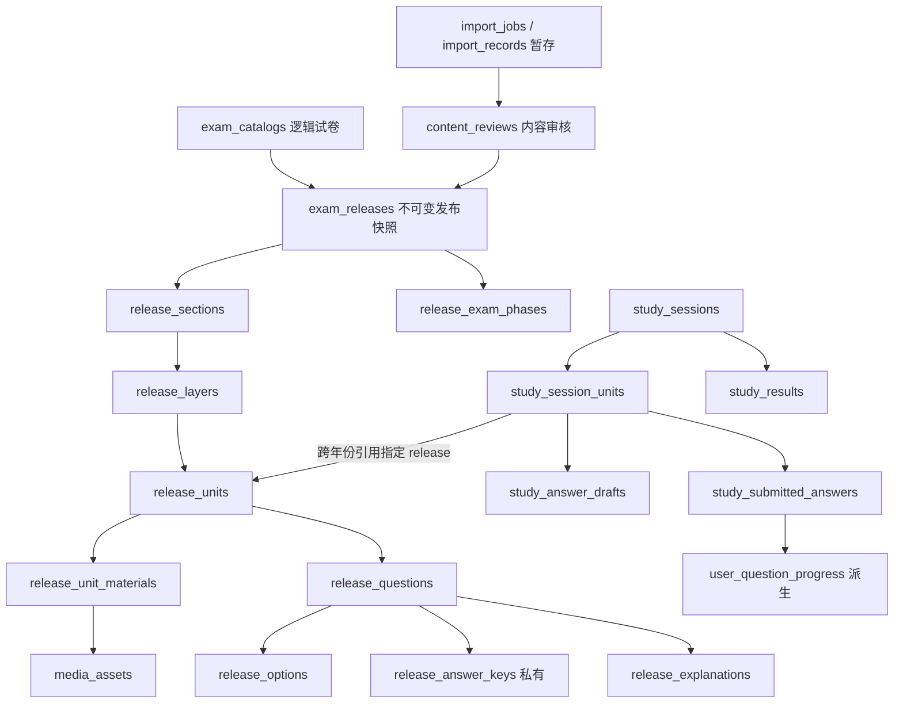

# JLPT GO 2.0｜PostgreSQL 领域模型与 Schema 设计 v0.2

> 日期：2026-11-15  
> 状态：**设计评审稿，未执行 SQL、未创建数据库、未修改 JLPT GO 1.0**  
> 输入依据：`JLPT_GO_Canonical_Schema_v2.0.md`、`VALIDATION_REPORT.md`、`Archive.zip` 中五套 Canonical 数据包，以及 2.0 产品决策。  
> 前置验证：N5/N4/N3/N2/N1 五包合计 **83 Layer、440 Unit、498 Question、204 MediaAsset**。结构对照与内容文件的可重复转换已有验证报告，**不代表答案/解析语言学正确或具有发布授权**。

## 1. 核心选择（建议定稿）

1. **Canonical Package 是交换契约，PostgreSQL 是查询/事务投影**。不强求 JSON 文件与 SQL 表一一对应。
2. 采用 **稳定逻辑 ID + 不可变发布快照**。逻辑 Question ID 跨修订不变；发布快照包含当时可见的题干、选项、材料、答案、解析和媒体引用。
3. **普通专项练习可以跨试卷抽题**。因此 `study_sessions` 不能只有一个必填 `release_id`；每条选中的 `study_session_units` 记录自己的 `release_id` 和 `unit_id`。严格模考在 Session 级固定整张试卷的 release。
4. **每个 Question 属于且仅属于一个 Unit；每个 Unit 至少一道题**。单题也有 Unit。Unit 是抽样/呈现/即时反馈最小边界，Question 是评分和长期学习统计最小边界。
5. **草稿、正式提交、完成成绩分离**。只在确定提交时留下正式 Answer；未答的 `chosen_option_id` 与 `is_correct` 均为 NULL。
6. 采用 **导入暂存/审核 → 一次性发布**。Agent 不直接改发布库；允许已发布快照撤下展示，但其内容历史不物理覆盖。
7. 试卷目录 Section（文字词汇/文法/读解/听力）与模拟考试 Phase（计时/播放阶段）独立建模。

## 2. 数据库领域总览



**注意**：此处 `exam_catalogs` 是逻辑试卷实体，`exam_releases` 是可供用户作答的版本快照。同一逻辑试卷可有多个 release。新版本不应通过 UPDATE 改写旧 release 内容。

## 3. 标识、时间、JSONB、命名约定

- 新系统持有的 Canonical `id` 使用 `text`，例如 `JLPTGO-N2-2018-12-ly-01-u01-q01`；数据库不复用源 `objectId`。`release_id`、`session_id` 等操作性 ID 使用 UUID。
- 同一 release 内以 **复合主键 / 复合外键** `(release_id, canonical_id)` 保证跨版本关系不会指错。
- 用户 ID UUID（认证模块另行定义）。时间字段 `timestamptz`，UTC 存储。
- 富文本 `jlptgo-richtext-v1`、字幕 cues、极少数题型扩展以 `jsonb` 保存；稳定关联、排序、选项、正确答案均结构化为列。
- `position` 为正整数；`printed_number` 为文本，保留 `01`、`1番`、`質問1` 等原貌。不要将印刷题号转换为数字。
- 建议 `text + CHECK` 管理状态，避免 PostgreSQL ENUM 后续扩展繁琐。具体约束可由迁移工具生成。
- Published 快照表不允许 UPDATE/DELETE，除非经专门维护流程；数据库写入权限与触发器应共同限制。发布状态/当前版本指针允许变更，但内容行不可变。

## 4. 逻辑注册表与发布

| 表 | 主键与关键字段 | 要求 |
|---|---|---|
| `exam_catalogs` | `id text PK`, `level`, `year`, `month`, `kind`, `title` | 同一等级/年月可以按 `kind` 区分；只有明确唯一范围时才设置唯一索引 |
| `question_registry` | `id text PK`, `exam_id FK`, `first_seen_at` | 稳定 Question 身份；重发修订不能换 ID；删除/替换题目需特别治理 |
| `exam_releases` | `id uuid PK`, `exam_id FK`, `revision int`, `content_hash char(64)`, `schema_version`, `published_at`, `state` | `UNIQUE(exam_id, revision)`；发布后内容固定；可对同包哈希幂等去重 |
| `exam_current_releases` | `exam_id PK`, `release_id`, `changed_at` | 复合 FK `(exam_id,release_id)` 保证当前版本确实属于同一试卷；撤回时可取消当前指针 |
| `question_types` | `id text PK`, `subject`, `label_zh`, `label_ja`, `answer_mode`, `default_unit_kind`, `is_provisional` | 保存 JLPT GO 语义 ID；题型 32–36 的暂定名称须审核 |

`exam_releases` 的不可变是指内容快照不可变，而非禁止管理状态从 `published` 变为 `withdrawn`。已存在的历史 Session 仍可引用旧 release 完成回顾。

## 5. 试卷内容快照（均带 release_id）

| 表 | 主键 | 关键列 / 关系 |
|---|---|---|
| `release_sections` | `(release_id, section_id)` | `subject`, `position`, `title`；`UNIQUE(release_id,position)` |
| `release_layers` | `(release_id, layer_id)` | `section_id`, `question_type_id`, `position`, `display_label`, `instruction jsonb`；FK 同 release Section |
| `release_units` | `(release_id, unit_id)` | `layer_id`, `question_type_id`, `kind`, `position`, `label`, `conversion_status`, `slot_ids jsonb`；FK 同 release Layer |
| `release_unit_materials` | `(release_id, material_id)` | `unit_id`, `kind`, `role`, `language`, `position`, `content jsonb`, `cues jsonb`, `asset_id nullable`, `translated_from_material_id nullable` |
| `release_questions` | `(release_id, question_id)` | `unit_id`, `question_type_id`, `position`, `printed_number text nullable`, `prompt jsonb nullable`, `slot_id nullable`, `conversion_status`；FK 同 release Unit，关联 `question_registry` |
| `release_options` | `(release_id, option_id)` | `question_id`, `position`, `content jsonb`；`UNIQUE(release_id,question_id,position)`；`UNIQUE(release_id,question_id,option_id)` 用于答案复合 FK |
| `release_answer_keys` | `(release_id,question_id)` | `correct_option_id`, `revision`, `review_status`；复合 FK `(release_id,question_id,correct_option_id)` → options，确保答案属于本题 |
| `release_explanations` | `(release_id,explanation_id)` | `question_id nullable`, `unit_id nullable`, `kind`, `language`, `content jsonb`, `revision`, `review_status`；**恰好一种 owner 非空**，按各自复合 FK 校验 |
| `release_question_media` | `(release_id,question_id,asset_id,role)` | 题目专属图片等，不与 Unit 共用材料混淆 |
| `release_option_media` | `(release_id,option_id,asset_id,role)` | 选项专属图片等，保留格式扩展 |

**数据约束**：
- `release_layers` 对 `(release_id,section_id,position)` 唯一；`release_units` 对 `(release_id,layer_id,position)` 唯一；`release_questions` 对 `(release_id,unit_id,position)` 唯一。
- `single` Unit **恰好一题**，所有可发布 Unit **至少一题**；这属于跨行检查，须通过发布事务里的校验查询执行，简单 CHECK 无法单独保证。
- `cloze` 的 `slot_id` 必须在同 Unit 的 RichText 锚点中唯一绑定；富文本完整性、材料 MIME 与字幕时间轴由版本化应用校验器保证，数据库保留结构化结果。
- 题干允许 `NULL`：纯图片题、听力题可由 Media/Unit Material 构成完整内容。不能把空标题当作删除理由。
- `release_answer_keys` 及未开放的解析必须由独立 API 权限隔离；`.private` 文件名并不是安全隔离机制。

### 5.1 媒体

| 表 | 字段 | 说明 |
|---|---|---|
| `media_assets` | `id text PK`, `sha256 char(64)`, `storage_key`, `mime_type`, `size_bytes`, `duration_ms`, `availability` | Canonical Asset ID 可与发布版本无关；共享同哈希二进制时允许引用同存储对象 |
| `release_exam_media` | `release_id`, `asset_id`, `role` | 整卷音频等，不强行塞到 Unit |

通过 SHA-256 与真实文件签名核验，不能只看扩展名：已观察到 `.jpg` 实际为 PNG。媒体未验证或缺失时阻断依赖该文件的 Unit 发布。媒体在本次 Archive 中仅有元数据，运行时仍须验证实际资源可访问。

## 6. 模考 Phase 与回放规则

| 表 | 主要字段 | 说明 |
|---|---|---|
| `release_exam_phases` | `(release_id,phase_id) PK`, `position`, `title`, `duration_seconds nullable`, `playback_policy jsonb` | Phase 是考试执行规则，而不是 Section 的别名 |
| `release_phase_units` | `(release_id,phase_id,unit_id)`, `position` | 明确哪些 Unit 属于哪个考试阶段，同一 Unit 只归属一个考场阶段（当前业务） |

- 若 `duration_seconds` 未经过核实，**不可启动标榜严格计时的模考**；样本源中的 `duration` 配置为空，不用空值伪造时长。
- 纯模拟成绩不得宣称为 JLPT 官方换算分；若实现估算分，应显示算法来源、版本及估算性质。

## 7. 导入、Agent 校验与审核流程

| 表 | 主要字段 | 说明 |
|---|---|---|
| `import_jobs` | `id uuid PK`, `package_id`, `content_hash`, `schema_version`, `converter_version`, `state`, `created_at`, `completed_at`, `report jsonb` | `UNIQUE(package_id,content_hash)` 幂等；哈希格式、归档哈希算法留版本号 |
| `import_records` | `(job_id,record_type,canonical_id) PK`, `payload jsonb`, `payload_sha256`, `validation_status`, `issues jsonb` | 暂存 Canonical，不等于可发布内容。`answer_key` 单独限制读取权限 |
| `source_mappings` | `source_system`, `source_archive_hash`, `source_object_id`, `source_node_path`, `canonical_type`, `canonical_id`, `raw_node_hash` | 追溯与稳定 ID 映射；允许源 ID 为空，使用稳定路径 + 节点指纹作为补充，不以来源 ID 为业务主键 |
| `content_reviews` | `id uuid PK`, `record_type`, `canonical_id`, `content_hash`, `reviewer_type`, `reviewer_id`, `review_status`, `evidence jsonb`, `checked_at` | 仅对特定内容哈希有效，内容变更需重新审查；Agent 输出不得自动当人工批准 |
| `publication_decisions` | `id uuid PK`, `exam_id`, `candidate_content_hash`, `decision`, `reviewer_id`, `decided_at`, `notes` | 记录为何允许或阻止发布；可单独管理内容授权证据 |

推荐导入流水线：

1. 验证 `manifest.files` 的哈希、字节数、Schema 版本及包内外键；同 hash 已完成导入则返回既有作业结果。
2. 写暂存和校验报告；不直接写 published 内容。
3. Agent 对完整 Unit 和 Question 校对，结果绑定内容哈希；启发式 A/B 切分、读解暂定题型需人工核对。
4. 管理员在 staging 中审阅/修正并重新产生候选内容哈希；**只有通过发布门槛**才允许发布。
5. 一个数据库事务写入新的不可变 release 内容、答案、解析和媒体关联，完成所有外键与逐 Unit 检查；事务成功后切换当前 release 指针。
6. 重复发布相同 `(exam_id,content_hash)` 的内容应返回已有 release，而非创建新快照。失败回滚、留下诊断报告。

### 发布闸门

- **专项练习**：仅允许抽取具备有效材料、已批准正确答案且所需资源可用的完整 Unit。
- **严格模拟**：整卷所有必需 Unit 满足闸门，并且已配置经过核实的考试阶段/计时/播放规则。
- 发布许可是独立检查项：**Canonical 格式自有不代表题目、图片、音频具有发布授权**。结构合法、Agent 通过均不替代授权判断。

## 8. 作答系统（普通专项 + 严格模拟共用核心）

### 8.1 会话与单位

| 表 | 主键 / 主要字段 | 约束 |
|---|---|---|
| `study_sessions` | `id uuid PK`, `user_id`, `mode=practice/mock`, `feedback_mode=immediate/end`, `state=in_progress/completed/ended_early/abandoned`, `mock_release_id nullable`, `config jsonb`, `version bigint`, `created_at`, `ended_at` | 模考必须固定 mock release；普通练习跨试卷，`mock_release_id` 应为 NULL |
| `study_session_units` | `id uuid PK`, `session_id`, `release_id`, `unit_id`, `position`, `state`, `submitted_at nullable` | `FK(release_id,unit_id)` 指向发布快照；`UNIQUE(session_id,position)`；同组所有 Question 取自同版 Unit |
| `study_phase_runs` | `id uuid PK`, `session_id`, `release_id`, `phase_id`, `started_at`, `expires_at`, `closed_at` | 模考阶段计时基于服务端时间；刷新不重置时钟 |

通过两个 **部分唯一索引**保证用户同一时刻最多有一个 `in_progress` 普通练习和一个 `in_progress` 模考。这是两个独立名额，不创建复杂待办列表。开始新普通练习时提醒旧会话将结束。

### 8.2 草稿与正式作答

| 表 | 主键 / 主要字段 | 约束 |
|---|---|---|
| `study_answer_drafts` | `(session_unit_id,question_id) PK`, `release_id`, `unit_id`, `chosen_option_id nullable`, `row_version`, `updated_at` | 必须引用该 Session Unit 所属版本的 Question；可反复更新，乐观锁防跨设备旧值覆盖新值 |
| `study_submitted_answers` | `(session_unit_id,question_id) PK`, `release_id`, `unit_id`, `chosen_option_id nullable`, `correct_option_id`, `answer_key_revision`, `is_correct nullable`, `submitted_at` | **追加后不可改写**；与发布版 Option/AnswerKey 快照关联；未答 `chosen=NULL AND is_correct=NULL` |
| `study_results` | `id uuid PK`, `session_id UNIQUE`, `correct_count`, `wrong_count`, `skipped_count`, `total_count`, `scoring_method`, `scoring_version`, `finished_at` | `CHECK(correct+wrong+skipped=total)`；只为正常完成/正式交卷生成完整结果；提前结束已提交答案依然留存 |
| `study_regrade_events`（预留） | `id`, `session_id`, `question_id`, `original_result`, `revised_result`, `reason`, `created_at` | 错误答案被纠正时可建立独立更正流水，不静默改写正式成绩 |

建议约束：

```sql
-- 示意：普通练习同一用户仅一个进行中会话
CREATE UNIQUE INDEX ux_one_active_practice
  ON study_sessions(user_id)
  WHERE mode = 'practice' AND state = 'in_progress';

-- 示意：模拟考试独立限制
CREATE UNIQUE INDEX ux_one_active_mock
  ON study_sessions(user_id)
  WHERE mode = 'mock' AND state = 'in_progress';

-- 示意：正式答案未作答不等于答错
CHECK (
  (chosen_option_id IS NULL AND is_correct IS NULL)
  OR (chosen_option_id IS NOT NULL AND is_correct IS NOT NULL)
)
```

注：上述 SQL 片段仅展示约束思想，不是一份可以直接运行的完整迁移文件。正式 DDL 必须按表创建顺序补齐主外键、权限和事务边界。

**强一致性要求**：
- 草稿与正式提交要通过复合 FK / 提交事务验证 Question 确实属于该 Session Unit 的 `(release_id,unit_id)`；所选 Option 确实属于本 Question。
- `submit_unit` 与 `finish_session` 都需要幂等键/唯一约束。重复点击不能重复增加统计或生成成绩。
- 即时反馈在提交 Unit 后开放该 Unit 的答案；统一反馈直到整场完成才开放；模拟直到交卷后才开放。正式提交后不允许修改当次选择。
- 用户提前退出：已提交 Question 参与学习历史，草稿不参与；不生成标称“完成整场练习”的结果。
- 关闭浏览器仅保留进行中状态，不属于提前结束；服务端是权威事实源。

### 8.3 跨试卷随机抽题为何必须在 Unit 上保存 release_id

一个 N2 文法练习可以同时选中：

- `study_session_units[1]`: 2018-12 N2 的 `release=A` + `unit=U1`
- `study_session_units[2]`: 2024-07 N2 的 `release=B` + `unit=U2`
- `study_session_units[3]`: 2025-12 N2 的 `release=C` + `unit=U3`

因此 Session 的 `mock_release_id` 只服务于完整模拟。**绝不能让普通随机会话的所有 Unit 都强制归属于同一试卷 release。**

## 9. 用户学习统计与智能随机

| 表 | 关键字段 | 作用 |
|---|---|---|
| `user_question_progress` | `(user_id, question_id) PK`, `attempt_count`, `correct_count`, `wrong_count`, `skip_count`, `last_valid_result`, `last_answered_at`, `last_seen_at`, `last_release_id`, `updated_at` | 从正式作答可重建的缓存，不是历史的权威来源 |
| `user_favorites` | `(user_id, question_id) PK`, `created_at` | 真题收藏；教材类扩展另定 |

- 用户历史错题不删除；`wrong_count>0` 表示「曾经答错」；`last_valid_result=false` 表示「最近仍错」；`true` 且历史有错为「最近已对」。
- 未答题独立记为 skip，不更新 `last_valid_result`；某题只遇到却未提交不计入 `attempt_count`。
- 不应仅按正确率低就永远重复抽同一题：按 Unit 聚合 Question 表现，并结合最近练习时间避开紧邻重复。
- 初始智能抽样策略以 **约 70%–80% 新 Unit + 20%–30% 历史低频/薄弱 Unit** 为软配额。具体比例按 Unit 数量计算，不把一篇有三题的文章当作三篇。
- 发布版修正答案时，用户历史记录保留原判定；派生进度可通过标记内容版本变化与校正事件重新计算，不能假装所有历史结果都按新版答案取得。

## 10. 关键索引与性能

| 索引 | 用途 |
|---|---|
| `exam_catalogs(level,year DESC,month DESC)` | 试卷列表 |
| `exam_releases(exam_id,revision DESC)` | 最新发布版本 |
| `release_units(release_id,question_type_id)` | 指定题型与发布范围 |
| `release_questions(release_id,unit_id,position)` | 单元完整题目与顺序 |
| `study_sessions(user_id,created_at DESC)` | 个人练习历史 |
| `study_session_units(session_id,position)` | 恢复原本抽题顺序 |
| `study_submitted_answers(question_id,submitted_at DESC)` | 历史/统计重建（按真实需要可进一步加 user_id 范围） |
| `user_question_progress(user_id,last_valid_result,last_answered_at)` | 错题筛选和复习候选 |

按 **真实数据量和 EXPLAIN ANALYZE** 再决定是否需要 GIN RichText 全文索引、物化视图、分区或缓存。目前无需 Redis、Elasticsearch 或微服务。

## 11. 第一批必须跑通的验收用例

| 用例 | 期望 |
|---|---|
| 重复导入相同 Canonical 包 | 不创建重复试卷、Unit、Question、Release |
| 导入五套样本 | 83 Layer / 440 Unit / 498 Question / 204 Asset 可核对，报错/待审核原样保留 |
| N2 文法問題9 | 1 Unit 包含 5 Question；slot 唯一对应 |
| N2 读解問題11 | 3 Unit，每 Unit 3 Question；相同文章只保存一次材料快照 |
| N1/N2 A/B 阅读 | 仍保留 `needs_review`，人工确认前不发布 |
| 看图听力 | `prompt=null` 但 Question/Unit 有正确媒体关联，不会被过滤 |
| 指定一个题型跨年份随机 | Session 单元分别引用来源发布版本；同时确保 Unit 完整 |
| 即时反馈提交 Unit | 同组所有题锁定，只开放本 Unit 反馈 |
| 统一反馈/模考 | 未交卷不泄露答案/解析；刷新后恢复并继续限时 |
| 带未答提交 | NULL 未答、错误、正确严格区分；结果统计一致 |
| 作答中发布新版答案 | 老 Session 坚持老 release；已提交成绩不被覆盖 |
| 同题重复请求/跨设备写入 | 通过幂等键、版本号和数据库约束避免双计/旧草稿覆盖新草稿 |

## 12. 下一步与明确待评审项

建议顺序：

1. 审核此版模型，尤其是 **内容 Release 的物理快照策略** 与 **跨试卷 Session Unit 引用**。
2. 基于五套 Canonical 样本编写一份可执行的 PostgreSQL DDL / Alembic 初始迁移（**仅在新的 2.0 开发库执行**）。
3. 编写 Canonical → staging 的幂等导入器和发布事务；通过库内计数、关联、哈希测试。
4. 构建基于 release 的只读题库查询 API，再接统一答题和用户进度。
5. 等待校验 Agent 分批交付审核结果，独立推进发布门槛和内容许可审核。

仍需评审：题型语义字典 32–36；A/B 切分复核；严格模考各阶段计时/音频播放政策；发布许可的证明与审核流程；旧版用户成绩是否迁移。**不得用这五套样本自动宣称 N5–N1 全部题库或答案已校验。**
