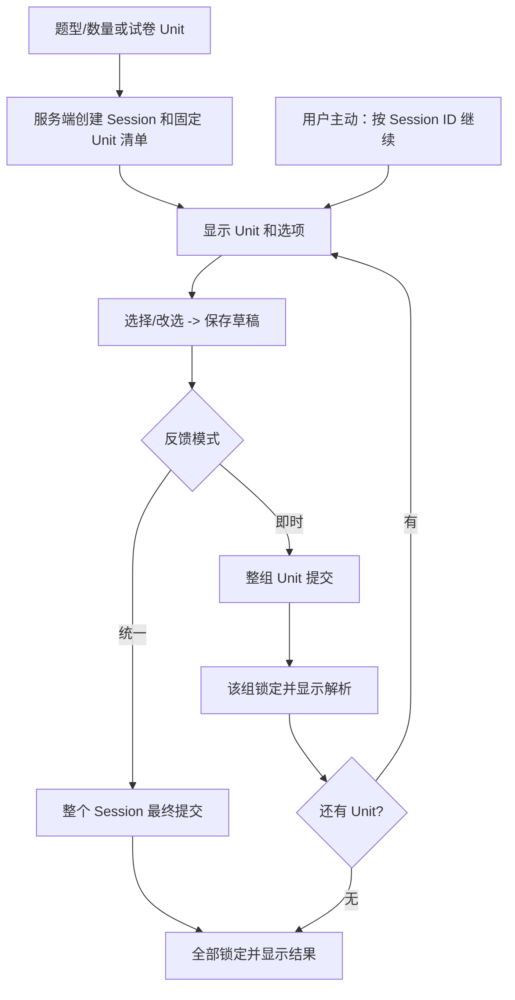

# 练习、提交、恢复与回顾的交互规范

> 本文是**用户端交互事实源**；业务判断/算法详见 `product/business-rules.md`。所有错误、提交与恢复状态都必须由真实 API 行为支持。

## 一次练习的用户流程

## 答题页面视觉顺序

1. 上部显示练习类型、进度、退出/返回操作；不为了装饰增加侧栏。
2. Unit 共享材料（文章/图/音频/字幕）在题目之前或 PC 双栏主阅读区。
3. Question 按印刷题号稳定排序；选项可改选直到所在 Unit 或 Session 正式提交。
4. 底部主要按钮语义明确：`提交本组` / `交卷` / `继续下一组`；保存状态是小型辅助文案。
5. 普通听力固定播放器底部；移动端底部内容留出播放器高度及系统安全区。桌面端播放器为与内容等宽的悬浮 Audio Dock（原文面板向上展开，提交/交卷前不得泄漏 cues），规格见 [`audio-player.md`](audio-player.md)。

## 状态矩阵

| 状态 | 用户可改选 | 可看答案 | 参与统计 | UI |
|---|---:|---:|---:|---|
| 未选择、未提交 | 是 | 否 | 否 | 选项全未选 |
| 已选草稿、保存中 | 是 | 否 | 否 | 选中 + 保存中 |
| 已选草稿、保存失败 | 是 | 否 | 否 | 选中 + 明确失败/重试 |
| 已选草稿、保存成功 | 是 | 否 | 否 | 选中 + 已保存 |
| Unit 正式提交（即时） | 否 | 是，仅该组 | 是 | 反馈头 + 正确答案 + 中性解析 |
| Session 尚未提交（统一） | 是 | 否 | 否 | 已选但无正误色 |
| Session 已正式提交 | 否 | 是 | 是 | 总结/按组复盘 |
| 严格模拟未交卷 | 取决于阶段规则 | **绝对否** | 暂无正式成绩 | 剩余时间/题号状态 |

## 提交前的未答确认

用户点击提交时，如果尚有未答：

- 文案例如「本次有 **3 道题未作答**。你可以继续答题，或确认提交。」
- 按钮 `返回答题`（不提交）与 `确认提交`（执行）必须可清楚识别。
- `skip` 只代表正式提交时该题未选择；不应把选择后清空的草稿算为正确/错误。
- 整组 Unit 提交后不能因为回到上一页而解锁；重复点击提交必须得到相同结果。

## 即时反馈与统一反馈

- **即时反馈**：只有 `submit_unit` 后才可展示该 Unit 全部小题答案和解析。文章 5 个空，不可第一空选完就揭晓整篇其他答案。
- **统一反馈**：Session 内不提前请求/展示答案。用户通过「上一题 / 下一题」和题号导航在整次练习的全部题目间移动，选择只保存草稿、整次提交前随时可改；不存在逐 Unit 的「提交本组」。最后一题「完成并提交练习」（有未答题时只确认一次）→ 服务端一次性提交并判题、生成结果（`POST /api/practice/sessions/{id}/submit`，同事务、幂等）。服务端对统一反馈会话拒绝逐 Unit 提交（409 `end_mode_requires_final_submit`），保证导航与草稿绝不写入正式答案；答案、解析、听力原文仅在会话完成后开放。
- **严格模拟**：按 Server Phase 和独立播放规则执行；即使用户使用开发工具检查普通响应，也不应该获取 correct_option_id。

## 普通练习中断与恢复

- **返回首页/刷新/关闭浏览器**：保持 `in_progress`；保存进度并允许从首页「继续上次练习」回来。
- **主动结束**：仅保留已正式提交 Question 的历史；未提交草稿不作为成绩，不产生完整的 `study_results`。
- **开始另一个普通/专项练习**（ADR-0016）：直接创建，不弹确认、不要求用户手动结束；服务端同一事务把旧的进行中练习标记为 `abandoned` 再创建新练习（创建失败则旧练习原样保留）。旧练习已正式提交的答案与历史保留，未提交草稿不计成绩且不再可恢复。同一时刻只有一份可恢复进度（首页「继续上次练习」只展示它）；完成后保存正式结果并清除可恢复状态。
- 用户没有有效提交就放弃可以记为 `abandoned`，是否保留空会话审计可由实现决定，但前端不能把它显示为完成历史。

## 保存/网络异常

- 服务端确认前不得显示「已保存」；失败显示可恢复提示（含重试）且保留屏幕上的草稿。
- 服务端 `version`/行版本用于防止跨设备旧草稿覆盖新草稿。收到 409 冲突时读取服务端最新会话并提示用户确认，不做静默覆盖。
- 提交以服务端为最终裁决，写入幂等键，前端 Loading 中禁重复触发；网络超时重试时先查询当前提交状态，避免双记分。
- 如果资料/音频不可用，明确显示「本题暂不可用」并提供返回/报错入口，不给默认答错。

## 结果与回顾

- **单题**：原地展开浅色反馈头、正确答案和解析，不跳庞大结果页。
- **多题**：简洁结果（正确、错误、未答），按 Unit 展开材料和原答案；优先可定位错题。
- **完整模拟**：独立成绩、阶段回顾、未答分布，不使用未经核实的 JLPT 官方换算分。
- **历史**：展示当时版本的题干、选项、材料与答案，不因为管理员后来改正答案而偷偷改写过去的成绩。

## 测试示例

1. 读解一篇 3 题、只选 2 题 → 提交组 → 正确/错误/未答三态；只计有答案题的已答正确率。
2. 文法填空 5 空，对应 slot ID 精确定位，提交前均可反复修改；一篇提交后全部锁定。
3. 做 4/20 题返回首页 → 继续练习恢复相同 Unit 次序；服务器没有保存成功时不能显示虚假的“已保存”。
4. 普通听力在 iPhone 窄屏固定播放器不会覆盖最后一项选项、底部提交或系统 home indicator。
5. 正在模考刷新 → 倒计时与 Phase 不重置，正确答案仍不可见。
