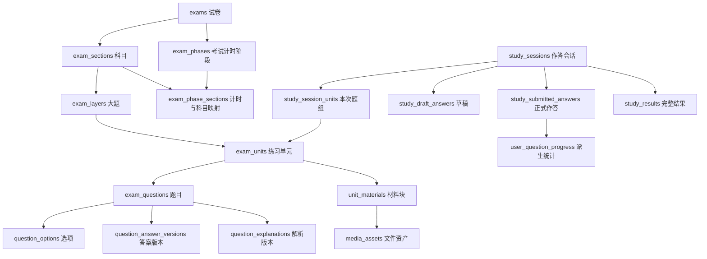

# JLPT GO 2.0｜数据库与领域模型设计 v0.1

> 日期：2026-11-15  
> 状态：**架构讨论稿，未定稿，不执行任何迁移或代码变更**  
> 依据：`JLPT_GO_2.0_PRD_v0.1.md`、上传的 `exams.json` / `questions.json` / `assets.json`、旧版 `database-schema.md`（仅供参考）。  
> 目标：2.0 全新、独立建设；1.0 保持运行。下面的 PostgreSQL 类型、关系、索引均属于**设计建议**，不是已执行的 Schema。

## 0. 设计边界与状态

**已确认的产品原则**：单选题型智能随机；真正共用材料的题完整抽取；按 Unit 提交即时反馈；统一反馈在练习结束后揭晓；允许未答题提交、未答和答错分离；历史错题永久保留，按最近有效正误筛选；用户偏向一个进行中的普通练习，不维护多任务列表；旧版继续服务，2.0 独立设计开发。

**架构建议，待最终评审**：Exam → Section → Layer → Unit → Question → Option；Unit 包括独立单题；正式答卷与草稿分表；对已发布内容做版本追溯；采用模块化单体与关系数据库。

**待验证**：导入分组、实际音频及图片可访问性、模拟考试的时间及播放规则、原始资料的合法发布资格、旧用户历史的迁移策略。

## 1. 总体关系

> 说明：`study_submitted_answers` 通过 `question_id` 关联原题，并存储答案版本与提交快照；上图省略该交叉连线以保持可读性。考试计时阶段与界面科目是两种不同概念。

## 2. 主键与通用约定

- 主键：新项目使用 `bigint` 自增或有序 UUID 均可；**本稿建议内容实体用 `bigint`**（方便内部关联），公开 API 使用不暴露内部含义的标识。用户 ID 使用 UUID。不能依赖源文件中的字符串作为数据库 PK。
- 外部标识：保留 `source_system`、`source_key` 和导入映射；同一份内容重新导入不应创建重复行。
- 排序：每一层有明确 `position integer`；同父级下 `UNIQUE(parent_id, position)`，不依赖字符串题号排序。
- 时间：`timestamptz`（UTC 保存，前端按时区显示）。
- 状态：使用约束过的枚举值或 `text + CHECK`，不要将语义复杂的状态塞进无说明的数字。
- 正文：日文题干、文章、解析采用受控富文本 `content_html text`；持久化之前校验 / 渲染之前净化。只对确实具有动态结构的字段使用 `jsonb`。
- 用户历史、资源文件以及人工校正记录不能因题库重新导入被直接覆盖或删除。

## 3. 内容领域：核心表

### 3.1 `exams`｜试卷

| 字段 | 类型 | 约束 / 含义 |
|---|---|---|
| `id` | bigint | PK |
| `level` | text | 非空，N1–N5 等 |
| `exam_year` | smallint | 非空 |
| `exam_month` | smallint | 非空，常见 7 / 12，不写死枚举 |
| `title` | text | 展示名 |
| `exam_kind` | text | 真题、授权模拟卷等，保留扩展空间 |
| `publication_status` | text | `draft / published / archived` |
| `full_audio_asset_id` | bigint nullable | FK `media_assets`，整卷音频（如有） |
| `created_at`、`updated_at` | timestamptz | 审计 |

建议索引：`(level, exam_year DESC, exam_month DESC)`；对于同一等级、年月和卷别，设置唯一约束。试卷题数原则上由题目关系统计或维护为可重建缓存，不作为唯一真实来源。

### 3.2 `exam_sections`｜试卷科目

| 字段 | 类型 | 约束 / 含义 |
|---|---|---|
| `id` | bigint | PK |
| `exam_id` | bigint | FK `exams`，非空 |
| `subject_key` | text | `vocabulary / grammar / reading / listening` 等内容分类 |
| `title` | text | UI 名称 |
| `position` | integer | 卷内排序 |

约束：`UNIQUE(exam_id, subject_key)`、`UNIQUE(exam_id, position)`。科目负责目录和专项分类，**不直接控制考试倒计时**。

### 3.3 `question_types`｜题型字典

| 字段 | 类型 | 约束 / 含义 |
|---|---|---|
| `id` | smallint | PK；可以承接历史的 11、12、21、23、31、46 等数字类型 |
| `subject_key` | text | 所属科目 |
| `name_zh`、`name_ja` | text | 展示名称 |
| `default_unit_kind` | text | 推荐的 Unit 形态，不是仅凭它决定全部分组 |
| `selection_mode` | text | 初期 `single_choice` |
| `is_active` | boolean | 是否向用户开放 |

建议将题型分类和分组算法分开：题型字典说明语义，导入规则根据源组号、材料和历史异常验证实际 Unit 边界。**原文件中题目 `question_type` 与大题类型不一致的记录不得静默强制覆盖。**

### 3.4 `exam_layers`｜考试大题

| 字段 | 类型 | 约束 / 含义 |
|---|---|---|
| `id` | bigint | PK |
| `section_id` | bigint | FK `exam_sections`，非空 |
| `question_type_id` | smallint | FK `question_types`，经校验的大题题型 |
| `title_html` | text | 原试卷问题说明，可包含下划线、星号等格式 |
| `display_label` | text | 如 `問題 7`；听力另起 `問題 1` 不冲突 |
| `position` | integer | 科目内排序 |
| `metadata` | jsonb nullable | 少量非通用元数据 |

约束：`UNIQUE(section_id, position)`。大题仅是卷面分类，不表示所有下属 Question 共用一份材料，也不表示必须整大题提交。

### 3.5 `exam_units`｜完整练习单元（核心）

| 字段 | 类型 | 约束 / 含义 |
|---|---|---|
| `id` | bigint | PK |
| `layer_id` | bigint | FK `exam_layers`，非空 |
| `question_type_id` | smallint | FK `question_types`，已校验后的实际题型 |
| `unit_kind` | text | `single / cloze / passage / comparison / visual / audio` 等 |
| `title` | text nullable | 如文章 2、听力 3；缺失可按位置自动展示 |
| `position` | integer | 大题内顺序 |
| `source_group_key` | text nullable | 原始父组号，**仅追溯，不参与运行时推断** |
| `publication_status` | text | `draft / published / blocked` |
| `metadata` | jsonb nullable | 带 Schema 版本的题型扩展属性 |

约束：`UNIQUE(layer_id, position)`；Unit 至少对应一题（应用层发布验证）。**每道题恰好属于一个 Unit；独立单题也有自己的 Unit。**

示例：2018-12 N2 文法問題7 → 12 个单题 Unit；文法問題9 → 1 个有 5 道 Question 的文章 Unit；读解問題11 → 3 个 Unit，各 3 道 Question；读解問題14 → 一组共享图片材料；听力問題5 → 3 组音频 Unit（1 / 1 / 2 道题）。以上来自样本观察，导入前逐项再次校验。

### 3.6 `unit_materials`｜共用材料块

| 字段 | 类型 | 约束 / 含义 |
|---|---|---|
| `id` | bigint | PK |
| `unit_id` | bigint | FK `exam_units`，非空 |
| `kind` | text | `text / image / audio / transcript / table` |
| `role` | text | `main / comparison_a / comparison_b / illustration / etc.` |
| `position` | integer | Unit 内显示顺序 |
| `content_html` | text nullable | 正文 / 比较文章 / 听力原文 |
| `timing_json` | jsonb nullable | 听力字幕时间轴，需规范校验 |
| `asset_id` | bigint nullable | FK `media_assets` |
| `language` | text nullable | 如 `ja` |

约束：`UNIQUE(unit_id, position)`；按 `kind` 校验正文或文件引用的有效性。这样一份 Unit 可以包含 A/B 对比文本、多张图片、一个音频及对应字幕，而不必将内容重复存到每道题。

### 3.7 `media_assets`｜媒体文件资产

| 字段 | 类型 | 约束 / 含义 |
|---|---|---|
| `id` | bigint | PK |
| `storage_key` | text | 对象存储 / 本地存储中的稳定路径 |
| `mime_type` | text | 真实类型，如 `audio/mpeg`，不能从 `images/` 推断 |
| `size_bytes` | bigint nullable | 文件大小 |
| `sha256` | text nullable | 内容去重 / 完整性校验 |
| `duration_ms` | bigint nullable | 音频时长（元数据可得时） |
| `status` | text | `missing / available / blocked` |
| `created_at` | timestamptz | 审计 |

建议索引：`UNIQUE(storage_key)`；可考虑对非空的 `(sha256, mime_type)` 去重。`exams.full_audio_asset_id` 关联整卷音频；仅属于一道 Question 的图片可以用后述 `question_materials`（确有需求时建，避免硬塞进 Unit 公共材料）。

### 3.8 `exam_questions`｜题目

| 字段 | 类型 | 约束 / 含义 |
|---|---|---|
| `id` | bigint | PK |
| `unit_id` | bigint | FK `exam_units`，非空 |
| `position` | integer | Unit 内顺序 |
| `display_number` | text | 原试卷题号，如 `58`、`質問 1` |
| `stem_html` | text | 每题自己的题干，可以为空（听力题） |
| `response_type` | text | 初期 `single_choice` |
| `publication_status` | text | `draft / published / blocked` |
| `created_at`、`updated_at` | timestamptz | 审计 |

约束：`UNIQUE(unit_id, position)`；不要按 `stem_html` 生成标题（原始听力题可能为空或为占位符）。题号允许在不同科目或大题重复；如需卷内顺序可使用单独 `exam_question_order` 派生字段 / 视图，不强制全卷唯一。

### 3.9 `question_options`｜选项

| 字段 | 类型 | 约束 / 含义 |
|---|---|---|
| `id` | bigint | PK |
| `question_id` | bigint | FK `exam_questions`，非空 |
| `position` | smallint | 1、2、3、4 等 |
| `content_html` | text | 可包含文字或经净化的富文本 |

约束：`UNIQUE(question_id, position)`；**选项表不保存 `is_correct` 字段**，避免在返回题目选项时意外泄露答案。

### 3.10 `question_answer_versions`｜答案版本

| 字段 | 类型 | 约束 / 含义 |
|---|---|---|
| `id` | bigint | PK，独立答案版本 ID |
| `question_id` | bigint | FK `exam_questions` |
| `version_number` | integer | 同题内自增 |
| `correct_option_id` | bigint | FK `question_options`，并验证其属于该题 |
| `status` | text | `draft / current / superseded` |
| `reviewed_by` | uuid nullable | 校对者 |
| `published_at` | timestamptz nullable | 版本发布 |

约束：`UNIQUE(question_id, version_number)`，并通过**部分唯一索引**确保每题最多一个 `current` 版本。发布必须在单个事务中完成旧版本退役与新版本启用。普通练习可在提交后按反馈规则获得答案；**完整模拟完成前不得通过 API 返回答案版本或解析。**

### 3.11 `question_explanations`｜解析版本

| 字段 | 类型 | 约束 / 含义 |
|---|---|---|
| `id` | bigint | PK |
| `question_id` | bigint | FK |
| `language` | text | 例如 `zh-CN`、`ja-JP` |
| `version_number` | integer | 同题同语言内自增 |
| `content_html` | text | 解析正文 |
| `translation_html` | text nullable | 译文（如有） |
| `status` | text | `draft / reviewed / current / superseded` |
| `source_kind` | text nullable | 人工 / AI 辅助等内容来源说明 |
| `published_at` | timestamptz nullable | 生效时间 |

建议约束：同题、同语言最多一个 `current` 解析版本；保留人工审核和更改轨迹。与答案版本独立，避免只改解析就要求重新发布正确答案。

### 3.12 `question_materials`｜题目私有资源（条件性表）

个别题的图片或音频确实仅属于本题（例如某道听力题独有图片）时使用：`id / question_id / kind / asset_id / position / role`。若所有实际材料都可合理归入 Unit，则第一阶段可先不启用该表，**但不要为满足统一结构将独立材料错误地复用给其他题。**

## 4. 考试规则领域（不能等同于科目）

### 4.1 `exam_phases`｜严格模拟计时阶段

`id / exam_id / position / title / duration_seconds / playback_policy / navigation_policy / time_policy_version`。

- 按官方或明确授权规则核定阶段时长；本批源 JSON 的 `duration` 为空，不能编造。
- `playback_policy` 可作为受版本约束的规则配置（JSONB）；不能只在前端隐藏进度条来实现严格限制。
- 同一阶段可能涵盖多个界面科目。

### 4.2 `exam_phase_sections`｜计时阶段与科目关联

`phase_id / section_id / position`，联合唯一键 `(phase_id, section_id)`；并校验两个对象属于同一份 `exam_id`。考试阶段的固定顺序、超时结束等由后端控制。初期可将这部分作为严格模拟功能的第二批详细建模对象，不阻挡题库内容的首轮导入。

## 5. 作答领域：正式历史与草稿严格分离

### 5.1 `study_sessions`

| 字段 | 类型 | 意义 |
|---|---|---|
| `id` | uuid | PK |
| `user_id` | uuid | FK `users` |
| `mode` | text | `practice / mock` |
| `status` | text | `in_progress / completed / ended_early / abandoned` |
| `end_reason` | text nullable | `user / timed_out / replaced / etc.` |
| `exam_id` | bigint nullable | 模考必填；专项可按来源选择填写 |
| `config_snapshot` | jsonb | 题型、数量、反馈方式、抽题算法版本 |
| `revision` | integer | 乐观并发控制，自增 |
| `started_at`、`ended_at` | timestamptz | 会话时间 |
| `last_activity_at` | timestamptz | 最近有效交互 |

**当前设计倾向**：一个用户最多有一个 `in_progress` 普通练习；模考另设一个 `in_progress` 限制。用数据库部分唯一索引保护，不仅依靠客户端判断。开始新普通练习时，必须先明确结束旧会话，并保留旧会话已经正式提交的答案。

### 5.2 `study_session_units`

| 字段 | 类型 | 意义 |
|---|---|---|
| `id` | bigint | PK |
| `session_id` | uuid | FK 会话 |
| `unit_id` | bigint | FK 原 Unit |
| `position` | integer | 本次会话的固定抽题顺序 |
| `status` | text | `pending / in_progress / submitted` |
| `submitted_at` | timestamptz nullable | Unit 正式提交时间 |
| `content_snapshot_ref` | text nullable | 关联不可变内容版本 / 快照（见版本策略） |

约束：`UNIQUE(session_id, position)`、通常 `UNIQUE(session_id, unit_id)`；一次练习不重复抽到相同 Unit。题库内容版本需要确保历史复盘显示当时的原文和选项，不能只保留可变当前数据。

### 5.3 `study_draft_answers`

`(session_id, question_id)` 联合主键；字段 `chosen_option_id nullable / updated_at / revision`。仅表示选择草稿，无正确与错误字段；存储可改写，服务端持久化。提交某 Unit 时在事务中将其相关题目的草稿转化为正式答案，并锁定该 Unit。

### 5.4 `study_submitted_answers`

| 字段 | 类型 | 意义 |
|---|---|---|
| `id` | bigint | PK |
| `session_id` | uuid | FK 会话 |
| `session_unit_id` | bigint | FK 会话 Unit |
| `question_id` | bigint | FK 题目 |
| `chosen_option_id` | bigint nullable | NULL 代表**已正式提交但未作答** |
| `answer_version_id` | bigint | 当时使用的正确答案版本 |
| `is_correct` | boolean nullable | 正确 `true`、错误 `false`、未答 `NULL` |
| `submitted_at` | timestamptz | 正式提交时间 |

约束：`UNIQUE(session_id, question_id)`；禁止一份会话对同题生成重复正式记录。跨表 FK / 业务校验确保 `question_id` 属于对应 Unit，选项属于该题，答案版本也属于该题。

**关键一致性**：`chosen_option_id IS NULL ⇔ is_correct IS NULL`；正式提交时后端根据锁定的答案版本判分，不能信任客户端提交的 `is_correct`。提交接口需要幂等键或以唯一约束 + 事务保证重试不重复记分。

### 5.5 `study_results`

`session_id` 唯一 FK；记录 `correct_count / wrong_count / skipped_count / total_count / scoring_policy_version / completed_at / duration_seconds`，并可包含 `display_score` / `score_type` 区分**原始得分率**与**估计分数**。只为正常结束的完整练习或已正式交卷的模拟生成；`ended_early` 可保留已提交题目历史，但不伪装成完整成绩。

历史结果不可因题库答案后来校正而静默重算；如确需重评分，须新增明确的审核/更正记录，保留原有成绩。

### 5.6 `study_phase_runs`（模拟专用）

`id / session_id / exam_phase_id / started_at / deadline_at / completed_at / status`。后端时间为准，刷新、重新登录不能重置计时。此表的规则需在取得可信计时规范后再细化。

## 6. 学习与管理领域

### 6.1 `user_question_progress`｜可重建汇总

联合主键 `(user_id, question_id)`；建议字段 `answered_count / correct_count / wrong_count / skipped_count / last_valid_result / last_answered_at / last_seen_at / updated_at`。

- 正确率只用 `correct_count / answered_count`，未答不参与分母。
- `ever_wrong = wrong_count > 0`；`last_valid_result` 根据**最近一次正式作答且非未答**确定。再次跳过不会抹除最近正误。
- `last_seen_at` 不能与正式回答次数混淆。
- 它是从 `study_submitted_answers` 派生的缓存，**不是新的历史真相源**。必须能重建，支持智能随机 70%–80% 新题 / 20%–30% 巩固的软配额。
- 分专项 vs 模考的统计口径需明确；如果要分别查询，可按来源派生分维度统计，不要静默混成一个“官方备考能力值”。

### 6.2 `user_favorites`

`user_id / question_id / created_at`；联合唯一 `(user_id, question_id)`。初期仅做真题内容时可简化。将来整合其他合法题库，需要抽象出跨来源的统一题目引用或将来源类型纳入主键，不能拿两个不同数据表的同号 ID 直接当成同题。

### 6.3 `import_batches`、`source_entity_maps`、`content_review_events`

- `import_batches`：每次导入的文件校验值、开始结束、导入数量、异常数和状态。
- `source_entity_maps`：`source_system / entity_type / source_key` → 新实体 ID；避免再次导入后产生重复内容。原始源 ID 只能作追溯，不应被当成用户可见或业务稳定主键。
- `content_review_events`：记录题目、答案、解析、材料的人工校正操作与前后版本，确保可审计。

**重要**：原始 JSON 应有不可变备份；导入规则可重复运行并产生校验报告。数据结构改变不代表获得原题、图片、音频及解析的版权或发布授权，公开发布须单独审查权利来源。

## 7. 版本与历史复盘策略（需要做设计决策）

只做 `question_answer_versions` 还**不足以**保证历史还原：如果旧文章后来被更改，历史回顾也不能直接展示“现在的文章”却假装是当时版本。

两种技术方案：

| 方案 | 优势 | 成本 |
|---|---|---|
| A. 发布内容不可变版本表（Unit、Material、Question、Option 的版本/发布快照） | 一份版本可被多次作答引用，长期更规范 | 更多关联表及发布流程 |
| B. 每次 Session 建立内容快照 JSONB（不含可提前泄露的答案） | 初期实现较快，历史还原简单 | 重复存储较多，题目更新和查询需谨慎 |

**建议**：长期选择 A；为降低 v2 首期复杂度，可先采用可追溯、不可变的“题库发布版本 / 内容快照”机制，然后按规模调整存储布局。无论选择哪个，都必须保留 `study_submitted_answers.answer_version_id`，并保证答案权限隔离。此项在开始编码前需要单独评审。

## 8. 样本导入映射与验证

### 8.1 样本规模

- `exams.json`：32 套 N2 试卷，合计 **608** 个大题记录。
- `questions.json`：**3,334** 道题；`question_id` 无重复。
- `assets.json`：**1,147** 条资源记录，包括 `audio/mpeg`、PNG、JPEG 和少量 `application/octet-stream`。
- 在样本中 1,538 道题的 `parent_id == layer_id`，另有 1,796 道并不相等；**不能简单根据 `parent_id` 数量直接计算 Unit 数**。
- 存在题目的 `question_type` 与所属大题 `questionType` 不一致的数据，需清单复核。

### 8.2 分组规则（初步，不作为无条件自动修复）

| 场景 | 初步映射 |
|---|---|
| 独立词汇 / 独立文法（如 11–22） | 每 Question 各自创建一个单题 Unit；即使 `parent_id == layer_id`，不合并 |
| 文章中的文法（23） | 共用文章一 Unit，多 Question |
| 读解（31–35） | 同大题内按经验证的 `parent_id`、文章内容识别 Unit；需要处理 A/B 对比文章 |
| 信息检索（36） | 按图片等共用材料创建 Unit；检查大题级 `image_path` |
| 听力（41–46） | 以音频及其关联问题为 Unit；同一大题可能有多个音频；46 可出现双问题音频 |

**注意**：已观察到 `question_type` 与大题不一致，故应先按试卷结构识别并校正分类，再做批量导入。不要简单按题目类型范围机械确定答案是否成组。

### 8.3 导入必须通过的校验

1. 对每份试卷、每个大题统计实际题数、层级完整性、顺序唯一性。
2. 每题恰好对应一个 Unit；Unit 至少一题；所有题有合法选项和对应答案版本。
3. `question_answer_versions.correct_option_id` 必须属于同一题；不只检查旧 `right_answer` 索引在范围内。
4. 共用材料组内文章、音频、图片归属一致；异议数据隔离为待审，不暗改。
5. 对多题音频，验证音频资源及字幕一致性，并检查时间轴是否可解析。
6. 媒体按 MIME 与文件真实可读取状态校验；不能根据 `.mp3` 后缀、`images/` 目录直接判断。
7. 模拟计时配置缺失时不得假装有经验证的正式规则。
8. 原始文件、转换映射、人工校正、问题清单能追溯；重复导入结果一致（幂等）。
9. 端到端验证样本：2018-12 N2 的文字词汇单题、問題9 文章文法、問題11 阅读三篇、問題14 共用图片、听力問題5 多问题音频。
10. 旧项目用户历史迁移若选择实施，必须做用户 / 试卷 / 题目 / 选项映射和数量对账；不能丢弃已有正式历史。

## 9. 性能与安全：初始索引 / 关键约束

| 表 | 建议索引或约束 | 意图 |
|---|---|---|
| `exams` | `(level, exam_year, exam_month)` | 年份等级检索 |
| `exam_layers` | `UNIQUE(section_id, position)` | 大题正确排序 |
| `exam_units` | `UNIQUE(layer_id, position)` | Unit 目录与定位 |
| `exam_questions` | `UNIQUE(unit_id, position)` | 题组内部定位 |
| `question_options` | `UNIQUE(question_id, position)` | 选项顺序稳定 |
| `question_answer_versions` | `UNIQUE(question_id, version_number)` + 每题唯一 current | 答案版本安全 |
| `study_sessions` | `UNIQUE(user_id) WHERE mode='practice' AND status='in_progress'` | 普通练习单活跃（若最终确定） |
| `study_session_units` | `UNIQUE(session_id, unit_id)` | 一组练习不重复抽相同 Unit |
| `study_submitted_answers` | `UNIQUE(session_id, question_id)` | 幂等提交与准确统计 |
| `user_question_progress` | `(user_id, last_valid_result)`、`(user_id, question_id)` | 错题筛选与智能抽题 |

实际智能随机查询应使用按等级和题型筛选后的候选集，再结合进度汇总、时间与可配置权重随机抽取；为规模增长预留批量抽样/预计算方案，但初期不必引入独立推荐服务、Redis 或分布式架构。

**安全底线**：普通练习提交前和所有未交卷的模拟都不能把答案版本、正确选项、完整解析作为题目数据一并下发；依业务阶段决定揭晓权限，后端独立判题。用户数据查询严格按认证身份隔离。

## 10. 先做哪一段？

建议先落地一个**独立新项目的最小纵向切片**，不迁动 1.0：

1. 评审本文件中 `Exam / Section / Layer / Unit / Question / Option` 的实际表结构与权限边界。
2. 确认内容版本策略（第 7 节）并实现最小可验证导入；选择 2018-12 N2 作样本。
3. 演示「试卷目录 → 单题或文章 Unit → 提交 → 反馈 → 结果 → 历史」闭环。
4. 补充严格模拟的可信计时规则、题目展示限制和音频规则。
5. 实现智能随机抽题与 B 类历史错题管理，核实抽样配额与进度汇总的一致性。
6. 完成版权/授权评估与媒体可用性验证后再考虑对外公开发布。

## 11. 待下一轮架构讨论的决策

- D-A：内容版本策略：发布版本关联 vs 会话内容快照（第 7 节）。
- D-B：`unit_materials` 是否需要结构化富文本块 / 占位符（例如文章文法 5 个空与对应 Question 的绑定）。
- D-C：模拟成绩如何区分原始题数正确率与任何估计的换算得分；计时规则如何输入。
- D-D：单个大题能否直接进入连续练习，产品此前建议支持但尚未正式确认。
- D-E：未来合法教材题库是否复用 Unit/Question 体系或保持独立来源适配。

---

*版本 v0.1 为方案草案：已建立整体关系、核心字段、约束与验证清单；没有执行 SQL、启动项目、修改线上数据库或操作用户账户。*
